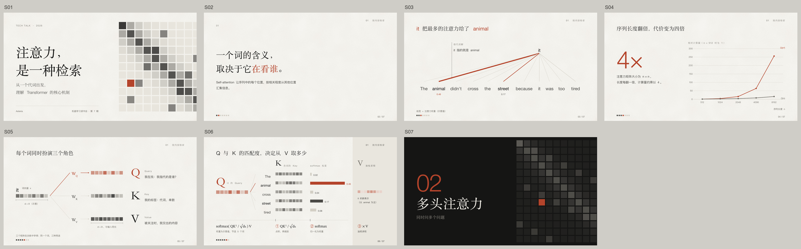

# Pretty Slides

一条和 AI 一起做演示的流水线：从一个主题出发，产出**原生可编辑、有设计感、没有 AI 味**的 PowerPoint。



## 为什么做这个

市面上的 AI 做 PPT，问题大多不在功能，而在审美：卡片网格、图标当项目符号、渐变色带、编号圆圈、千篇一律的“标题 + 三栏”。它们让每一页都“像幻灯片”，却没有一页是为自己的内容设计的。

Pretty Slides 换了一种做法：

- **排版和留白是主要的设计手段**：一页一个主角，字号对比大，一种强调色，用细线代替盒子。引擎里根本没有“卡片”和“图标”这类部件。
- **讲解页必须有图，页面靠结构层丰富**：讲解机制的页面一定有一张承担机制的图解；导航框架、引导线、尺寸线、色块分区、纸张颗粒这些承载信息的细小元素，让纯色页面不再单调。
- **先设计，再制作**：设计文稿把每一页要做成什么样写到可以直接制作的程度。
- **先看样张，再做整套**：3–5 页真实的样张先让你确认视觉语言，它们之后原样进入成稿。
- **每个阶段在新会话里只读文件**：上下文干净，你的偏好和禁令都记录在文件里，不会在长对话里丢失。
- **渲染才算数**：每次修改都会渲染出图，AI 自己先看过，再给你看。

## 工作流

| 步骤 | 你做什么 | 命令 | 产出 |
|---|---|---|---|
| 0 立项 | 给一个主题 | `/new-deck 注意力机制入门` | `projects/<slug>/` |
| 1 内容 | 和 AI 聊：受众、时长、目标、材料；审阅文稿 | （直接对话） | `01-content/content.md` |
| 2 设计 | 审阅设计文稿，提意见，认可 | `/design` | `02-design/design.md` |
| 3 样张 | 看 3–5 页真实样张，确认视觉语言 | `/reference` | `03-reference/*.pptx` |
| 4 成稿 | 等待 | `/build-deck` | `04-deck/out/<slug>.pptx` |
| 5 修改 | 逐页提意见，想改几轮就改几轮 | `/revise S03 标题太大` | 前后对比 + 修改记录 |

第 2、3、4 步会自动开启**独立的新会话**（fork），只依据项目文件工作，完成后把结果交回给你审阅。每一步都需要你明确说“可以”，才会进入下一步。

在 Claude Code 中打开本仓库即可使用。其他 Agent（如 Codex）可以先读 `AGENTS.md`，再按 `.claude/skills/*/SKILL.md` 执行。

## 规范按需加载

`AGENTS.md` 只放每次都需要的规则。其余规范放在 `guides/` 里，只在用到时读取：

| 文件 | 何时读 |
|---|---|
| `guides/content.md` | 写内容文稿 |
| `guides/design-doc.md` | 写设计文稿 |
| `guides/aesthetic/principles.md` | 设计原则与取舍优先级 |
| `guides/aesthetic/anti-ai.md` | 去 AI 味：禁用清单与好的样子（每一步都读） |
| `guides/aesthetic/typography.md` | 字体（只列本机已验证的）、字号层级、中文排版 |
| `guides/aesthetic/color.md` | 色板配方（已校验对比度） |
| `guides/aesthetic/composition.md` | 网格、构图动作、节奏、结构层、章节页 |
| `guides/aesthetic/imagery.md` | 图片来源与处理 |
| `guides/aesthetic/data-and-diagrams.md` | 图表、图解、公式、代码 |
| `guides/aesthetic/motion.md` | Morph 与转场 |
| `guides/production/engine.md` | 引擎 API |
| `guides/production/review.md` | 渲染自查（硬规则、软规则、不准动的范围） |

## 制作引擎

`engine/` 是 [pptxgenjs](https://github.com/gitbrent/PptxGenJS) 外的一层薄封装：

- **原生可编辑**：文字、形状、线条、原生图表、表格都可以在 PowerPoint 中直接修改。
- **设计令牌**：每个 deck 的 `theme.js` 锁定颜色、字体、字号和网格。页面代码只引用令牌。
- **Morph**：同名对象跨页自动配对（PowerPoint 的 `!!name` 约定），用连续的页面代替逐项动画。
- **几何 QA**：检查是否越界、文字溢出、文字重叠、对比度不足、字号过多，以及字体是否已安装。
- **渲染**：通过 LibreOffice 输出逐页 PNG 和缩略总览；保留上一版渲染，方便做前后对比。
- **手工修改回写**：`engine/dump.js` 读出你在 PowerPoint 中手动修改过的对象，AI 再把修改同步回代码。

```bash
npm --prefix engine install
node engine/make.js examples/attention          # 构建示例
```

依赖：Node.js 18+、LibreOffice、poppler（`pdftoppm`）、ImageMagick 7。macOS：`brew install --cask libreoffice && brew install poppler imagemagick`。

## 已知限制

- 预览由 LibreOffice 渲染，与 PowerPoint 有细微差异（中西文之间的间距、个别行高）。最终请在 PowerPoint 中检查。
- Morph 只能在 PowerPoint 中放映验证。不生成页内逐项动画，也不生成可编辑的 OMML 公式。
- pptx 不嵌入字体：播放的电脑上必须装有设计中使用的字体。

## 已知问题（待修）

- **字体在 PowerPoint 与预览之间不一致。** 示例 S05 的 Q/K/V 写的是 `Songti SC`（已安装），PowerPoint 中却显示为无衬线体；`PingFang SC Medium` 这类带字重后缀的字体名，LibreOffice 有时会解析成别的字体（例如 S05 的标题被渲染成了衬线体）。待查：PowerPoint 中选中这些文字时字体框显示的名称，以及中文是否也被替换。可能的修法：西文使用独立的西文字体（`fontPairs`，例如 `Songti SC → Baskerville`）；字重用“家族名 + 粗体”代替字重后缀名；字体推荐表按 PowerPoint 的实际表现重新核对。

## 许可

MIT，见 [LICENSE](LICENSE)。
