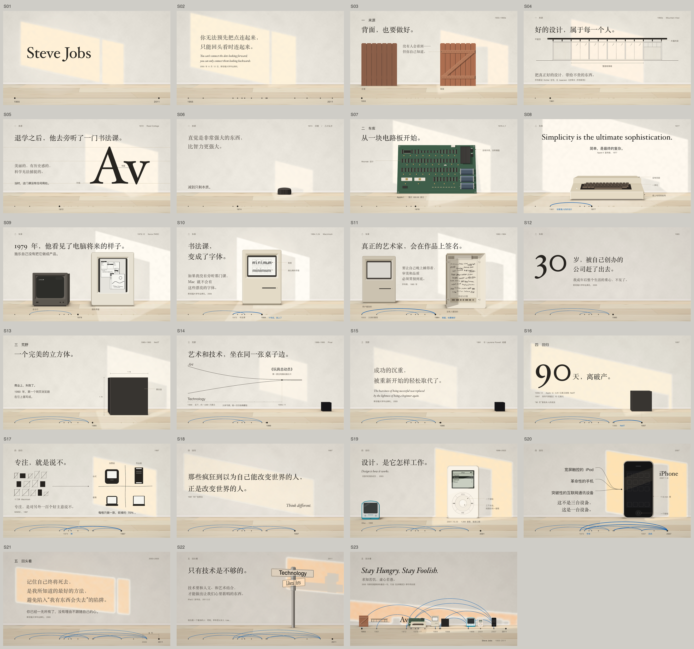
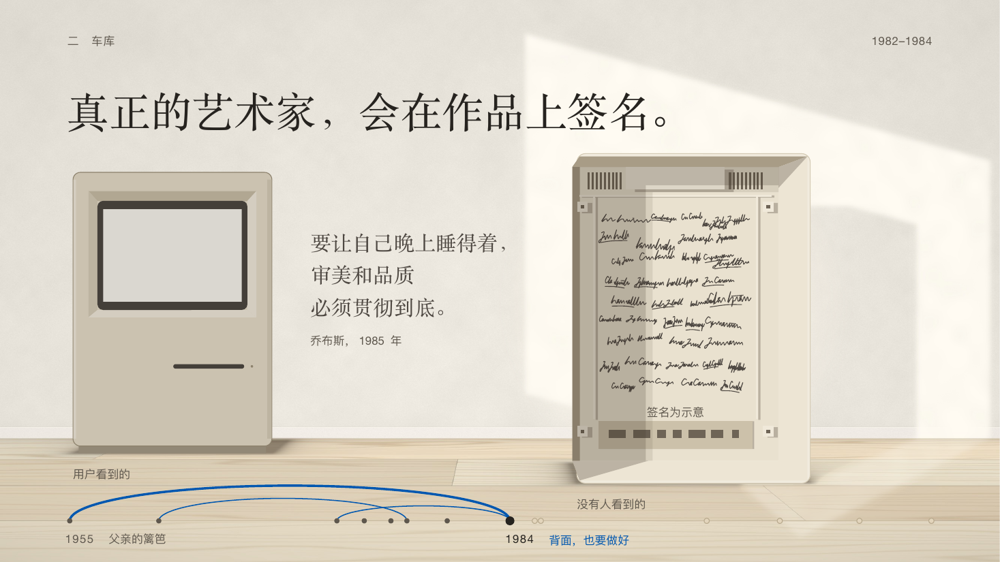
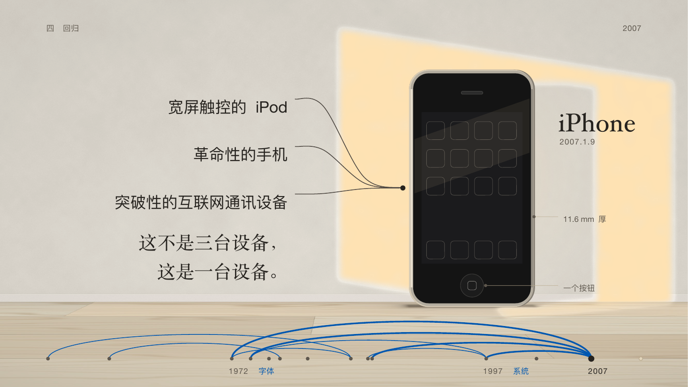
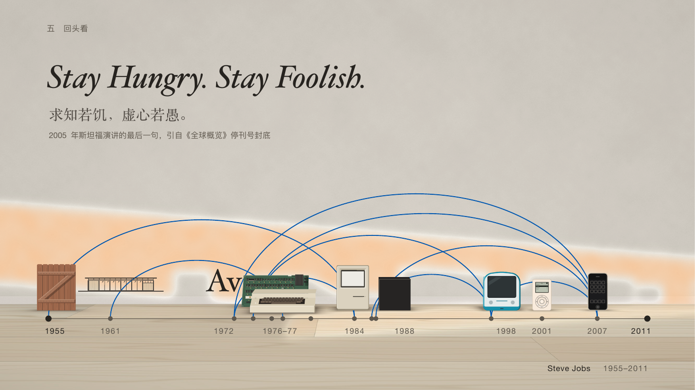
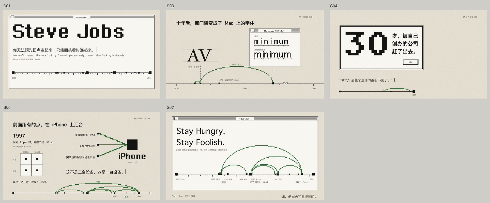
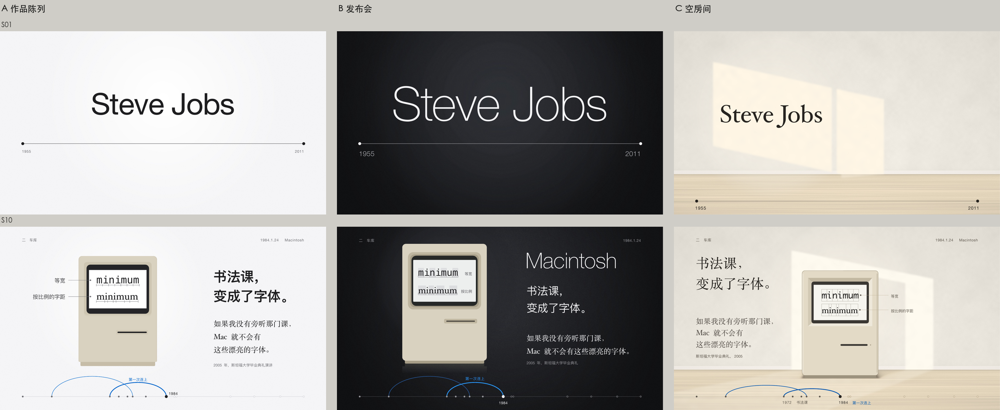

# Steve Jobs 的一生 · 空房间

23 页，原生可编辑的 PowerPoint。完整走过 Pretty Slides 的每一步：内容文稿 → 设计文稿 → 三个方向并排对比 → 样张 → 四个会话并行补页 → 整合。



```bash
node engine/make.js examples/steve-jobs     # 构建 + QA + 渲染全部 23 页 → out/steve-jobs-life.pptx
```

## 意象：如果他来做这套演示

乔布斯是一个把审美当作信仰的人。所以设计不问“他的故事像什么”，而问：**如果乔布斯来做这套关于他自己的演示，他会怎样做？**

答案是 1982 年他那间几乎空着的客厅：他找不到足够好的家具，宁可什么都不放。整套演示就是这一间房间：

- **每页只放一件东西**（简单是最终的复杂）。房间里一共只出现他一生里的几样东西：父亲的篱笆、一对字母、Apple I、Apple II、Macintosh、NeXT 立方体、iPod、iPhone。
- **每件东西都按真实尺寸画**（看不见的地方也要做好）：Mac 128K 按 244 × 345 mm，屏幕按 512 × 342 像素；iPhone 按 61 × 115 × 11.6 mm；Apple I 的芯片按真实板子的四行布局。
- **画出它怎样工作**（设计是它怎样工作）：Mac 的屏幕上，同一个词用等宽和按比例两种字距各排一遍，每个字母画在它真实占的格子里；iPod 画出滚轮的三下点击。
- **两种声音**（技术与人文的十字路口）：墙上写的话是衬线（Songti SC / Hoefler Text，1991 年随 Apple System 7 发布），事实、年份、标签是无衬线。

**太阳是时间。** 窗外的阳光从封面的清晨走到最后一页的黄昏，他的一生是一天。阳光不是画的：`room.py` 按房间的相机、窗和每件物件的真实尺寸算出每一页的光斑和影子，所以物件和它的影子永远对得上。节奏由光本身完成：

| 页 | 时刻 | |
|---|---|---|
| S01 | 清晨 | 名字落在窗光里 |
| S10–S11 | 正午 | 最白、最清楚：Mac 和它机箱里的签名 |
| S12 | **阴天** | 30 岁被开除。没有太阳，全片最低点 |
| S20 | 金色时刻 | iPhone，全片最强的光 |
| S23 | 最后的光 | 一道贴着墙脚扫过的低光，他做的东西站成一排 |

**蓝线只有一个意思：回头才看得见的联系。**地板上那条缝是他的生命线；书法课连向 Mac 的字体，父亲的篱笆连向机箱内壁，禅连向一个按钮。到最后一页，9 条线全部出现。

## 签名画面

| | |
|---|---|
|  | **S11 机箱里的签名**：用户看到的那一面站在阴影里，没有人看到的那一面在光里。与 S03 父亲篱笆的“正面 / 背面”同构 |
|  | **S20 iPhone**：发布会原话“三台设备，其实是一台”。翻页时 S19 的 iPod 通过 Morph 变成 iPhone |
|  | **S23 回头看**：全片唯一一次看到线的全貌 |

## 来龙去脉：第一版被否决

第一版从斯坦福演讲里“把点连起来”这句话出发，做成了“连点画册 / 1-bit 像素屏”。画面有想法，用户的评价是：

> 设计的时候没有围绕内容来……他是一个很重审美的人，他有自己的 apple 美学和哲学在里面……设计一定要和内容，和人物相关，一定要理解内容，理解人物本身。



问题出在上游：内容文稿只写了他的生平，没有写他的审美；设计会话只读文件，于是从一句引言里借了一个比喻，却看不出乔布斯是谁。修正也在上游：

1. 内容文稿补了一章「人物：他的审美与哲学」，每一条附来源（[docs/content.md](docs/content.md)）。
2. 规范补了一条：主题是一个人、一个品牌或一件作品时，它自己的审美是设计的第一来源（[guides/aesthetic/principles.md](../../guides/aesthetic/principles.md) 第 1 条）。
3. 重写设计文稿，三个候选方向都从他本人出发：他做的**产品**（作品陈列）、他讲东西的**舞台**（发布会）、他生活的**房间**（空房间）。并排对比后选定空房间（[docs/design.md](docs/design.md) 第 2、11 节）。



## 目录

| 文件 | 内容 |
|---|---|
| [docs/content.md](docs/content.md) | 内容文稿：叙事主线、人物的审美与哲学、逐页正文，每条事实附来源 |
| [docs/design.md](docs/design.md) | 设计文稿：视觉语言的来源、三个方向、设计系统、节奏表、逐页方案、样张与整合回写 |
| [making-a-page.md](making-a-page.md) | 补页手册：房间几何、太阳时刻函数、物件约定、并行补页规则、检查清单 |
| `room.json` · `room.py` · `rooms/` | 房间几何与每页的太阳；`python3 room.py S10` 只重算一页的光（需要 numpy、scipy、Pillow） |
| `objects/` | 每件物件一个文件：真实尺寸 + 画法 |
| `slides/` | 23 页，每页一个文件，写满演讲者备注 |
| `lane.sh` | 并行补页时各自构建，互不干扰 |

## 已知限制

- 预览由 LibreOffice 渲染，不能播放 Morph 和页内动效。跨页 Morph（S07→S08 电路板装进机身、S09→S10 施乐的屏幕变成 Mac、S19→S20 iPod 变成 iPhone、S22→S23 拉远）要在 PowerPoint 里放映确认。
- 阳光是每页一张生成的透明图片，在 PowerPoint 里不能当形状编辑；改光要改 `rooms/<ID>.json` 再跑 `room.py`。
- 字体全部是 macOS 系统字体；在 Windows 上播放请用 PDF。
- 物件按公开的产品外形与尺寸原生绘制，不使用任何商标和照片；S11 的签名是程序生成的示意笔迹。
